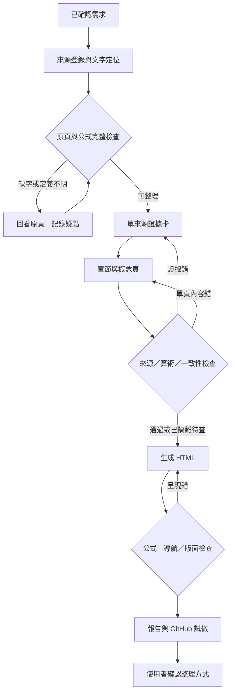

# 匯入與產出流程

## 本次已執行的 Graph

HTML 閱讀器將 Mermaid 保留為可讀流程原碼；本頁下方文字是等價的離線說明，GitHub 可渲染圖。

文字流程：需求 → 來源登錄 → 原頁／公式關卡 → 證據卡 → 概念頁 → 內容檢查 → HTML → 呈現檢查 → 上傳 → 使用者檢視。缺字就回原頁，主張錯回證據卡，版面錯只修呈現層；未解問題列入台帳並排除肯定結論。

## 每個節點的輸入與輸出
| 節點 | 輸入 | 輸出 | 檢查 |
| --- | --- | --- | --- |
| 登錄 | 原始 PPT | sources/catalog.json | 檔名、頁數、雜湊 |
| 擷取與原頁核對 | PPT 文字與本機匯出圖 | coverage.json | 全頁覆蓋、公式方向與單位 |
| 證據卡 | 單份教材與頁碼 | evidence/ | 是否支持主張、疑點分離 |
| Wiki | 證據卡與明示補充 | wiki/ | 頁碼、符號、數值及跨頁一致性 |
| HTML | Markdown | index.html 與 site-data.json | 來源內容不被呈現層改寫 |
| 驗收 | HTML、Wiki 與來源 | reports/ | 自動檢查＋瀏覽器操作＋人工原頁核對 |

## Loop、停止與設計理由
每個節點最多修 3 輪，只修報告列出的問題；來源缺漏／定義不清先隔離該項，不反覆重寫整份。小圈修正讓錯誤靠近來源被發現，也避免排版階段改動已核對內容。這是檔案與腳本構成的 workflow prototype，尚非獨立排程的全自動代理系統。

## 簡報 Graph（規劃歷史，實際結果見第三階段）
查詢 Wiki → 證據覆蓋率 → 教學大綱與人工確認 → 逐頁稿 → 忠實度 → HTML 簡報 → 渲染。教材／Wiki 有待查事項時，不把它轉成無保留結論。簡報頁數與詳細教學目標留待下一階段討論。

[本次結果](../reports/pilot-02.md) · [工作 SOP](../SKILL.md)

## 第二階段：已執行的批次與互動節點
批次一 S01／S03 → 結構／引用／公式語法檢查 → commit；批次二 S04／S06 → 同樣檢查 → commit；批次三 S05／S07 → 同樣檢查 → commit。各批保留原始檢查快照，不用最終成功結果覆蓋歷史。

互動新增路線：通過查核的公式 → 純數值模型 → 已知值／幾何不變量與退化測試 → UI 控制與圖形 → 桌面／手機操作 → GitHub Pages。算式錯退回數值模型；狀態或排版錯只修 UI。瀏覽器中的示例永遠標為模型示意，不加入實驗成果表。[本次紀錄](../reports/course-import.md)

## 第三階段：初學者 HTML 簡報（2026-11-22）
已執行：查詢 Wiki → 核對來源與假設 → 22 頁稿 → HTML／共用互動 → 數值與公式檢查 → 桌面／手機驗收 → GitHub Pages。來源錯退回證據，敘述錯退回頁稿，版面錯只修 HTML／CSS。[本次實際檢查與修正](../reports/slides-check.md)。
